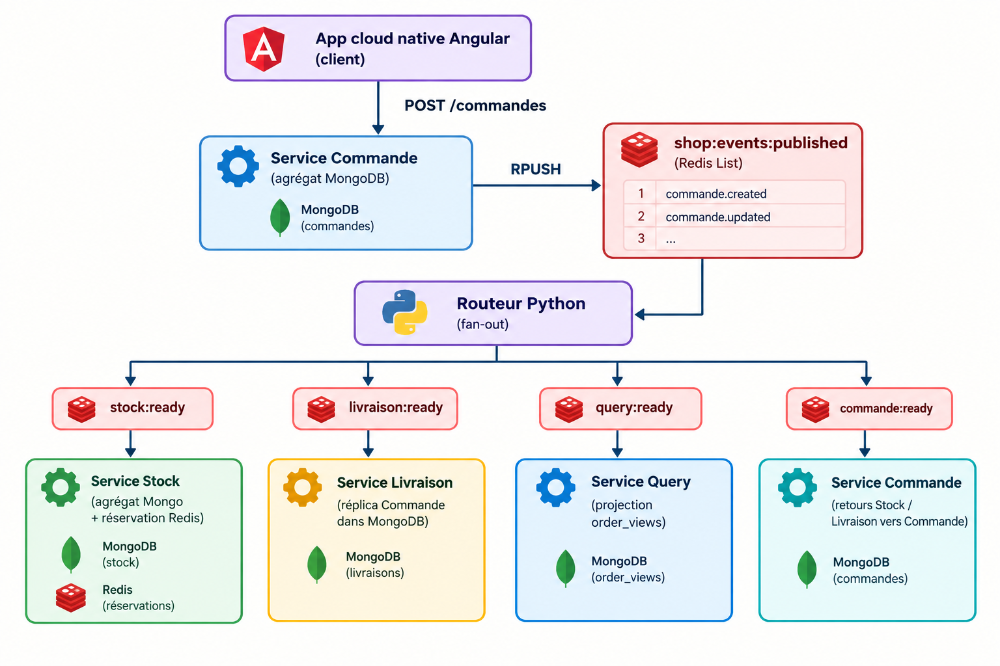
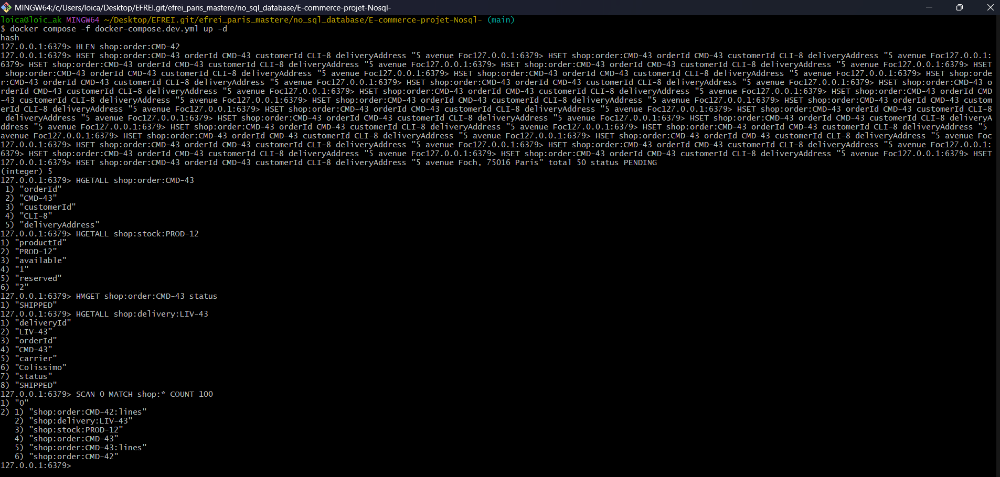
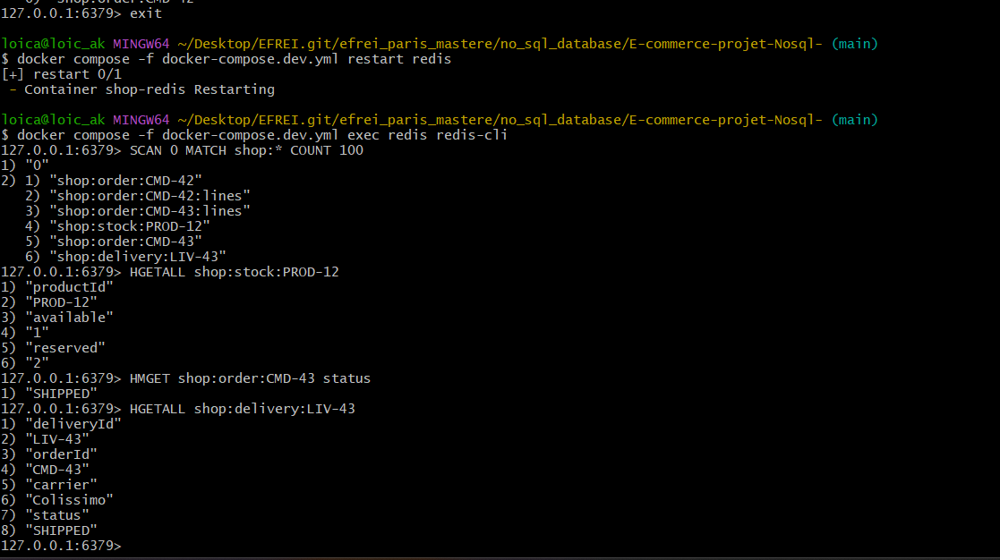

# E-commerce Cloud Native – Projet NoSQL

Projet de groupe du cours **NoSQL – M1 Data Engineering & IA (EFREI Paris)**.
Conception d'une marketplace e-commerce cloud native composée de plusieurs services découplés par événements.

## Équipe

| Membre | GitHub |
|---|---|
| Loïc AKAMGA | [@LOIC754](https://github.com/LOIC754) |
| Deiss YEHOUENOU | [@CharmanY](https://github.com/CharmanY) |

---

## Sommaire

1. [Étape 1 – Initialisation du projet](#étape-1--initialisation-du-projet)
2. [Étape 2 – Les services](#étape-2--les-services)
3. [Étape 3 – Les agrégats](#étape-3--les-agrégats)
4. [Étape 4 – Découplage par événements et réplica](#étape-4--découplage-par-événements-et-réplica)
5. [Étape 5 – Projection](#étape-5--projection)
6. [Stockage des agrégats dans Redis](#stockage-des-agrégats-dans-redis)
7. [Gestion de la survente](#gestion-de-la-survente)
8. [Persistance de Redis](#persistance-de-redis)
9. [Lancer le projet](#lancer-le-projet)
10. [Arborescence](#arborescence)

---

## Étape 1 – Initialisation du projet

- Équipe de 2 personnes.
- Dépôt Git créé, enseignant invité.
- Descriptif du projet : ce README.

**Problème métier traité** : un client passe une commande sur une marketplace. La commande doit être validée par rapport au stock disponible, **sans survente** (exemple : un client commande 10 articles alors qu'il n'en reste que 3), puis être livrée.

---

## Étape 2 – Les services

L'application est découpée en services. Chaque service **possède son propre agrégat** et ne lit jamais les données d'un autre service directement.

| Service | Responsabilité | Agrégat possédé |
|---|---|---|
| **Commande** (`orderService`) | reçoit la commande du client, émet les événements de commande | Commande |
| **Stock** (`stockService`) | réserve les articles et empêche la survente | Stock |
| **Livraison** (`deliveryService`) | prépare et expédie la commande à partir d'un réplica | Livraison (+ réplica Commande) |
| **Query** (`orderQueryService`) | construit une vue consolidée pour l'affichage client | Projection `order_views` |

### Architecture


Comme dans le projet de l'enseignant, **Redis coordonne la livraison des événements** entre services. Le routeur copie chaque événement dans **une file par service consommateur**, car une List Redis est consommée de façon destructive (`LPOP` / `LMOVE`) : avec une file partagée, un événement ne serait reçu que par un seul service.

---

## Étape 3 – Les agrégats

Un agrégat est une frontière transactionnelle métier : il est modifié en une seule opération par le service qui le possède.

### Agrégat Commande

```json
{
  "orderId": "CMD-42",
  "customerId": "CLI-7",
  "lines": [
    { "productId": "PROD-12", "quantity": 10 }
  ],
  "deliveryAddress": "12 rue de Paris, 94120 Fontenay",
  "total": 250,
  "status": "PENDING"
}
```

Statuts possibles : `PENDING` → `CONFIRMED` ou `REJECTED` → `SHIPPED`.

### Agrégat Stock

```json
{
  "productId": "PROD-12",
  "available": 3,
  "reserved": 0
}
```

### Agrégat Livraison

```json
{
  "deliveryId": "LIV-43",
  "orderId": "CMD-43",
  "carrier": "",
  "status": "WAITING"
}
```

Statuts possibles : `WAITING` → `SHIPPED`.

---

## Étape 4 – Découplage par événements et réplica

### Enveloppe commune des événements

```json
{
  "eventId": "uuid",
  "type": "OrderCreated",
  "version": 1,
  "occurredAt": "2026-10-26T12:00:00Z",
  "aggregateId": "CMD-42",
  "payload": {}
}
```

Le champ `eventId` sert à l'**idempotence** : chaque service enregistre les `eventId` déjà traités pour ignorer un événement reçu deux fois.

### Liste des événements

| Événement | Émetteur | Récepteurs | Donnée modifiée | Nouvelle valeur |
|---|---|---|---|---|
| `OrderCreated` | Commande | Stock, Livraison, Query | commande complète | lignes + adresse → **crée le réplica** dans Livraison |
| `StockReserved` | Stock | Commande, Livraison, Query | `status` de la commande | `CONFIRMED` |
| `StockRejected` | Stock | Commande, Query | `status` de la commande | `REJECTED` |
| `DeliveryAddressChanged` | Commande | Livraison, Query | `deliveryAddress` | nouvelle adresse → **met à jour le réplica** |
| `OrderShipped` | Livraison | Commande, Query | `status` de la commande | `SHIPPED` |

### Réplica de la Commande dans le service Livraison

Le service Livraison ne garde que les données de la commande dont il a besoin. Le réplica est **créé** par `OrderCreated` et **mis à jour** par `DeliveryAddressChanged` et `StockReserved`.

```json
{
  "orderId": "CMD-43",
  "deliveryAddress": "5 avenue Foch, 75016 Paris",
  "itemsCount": 2,
  "orderStatus": "CONFIRMED",
  "lastEventId": "uuid"
}
```
---

## – Événements et réplica en ligne de commande

Les événements circulent dans des **Lists Redis**, selon le protocole du cours : publication → routeur (fan-out) → une file `ready` par service → traitement → acquittement.

### Clés utilisées

| Clé | Type | Rôle |
|---|---|---|
| `shop:events:published` | List | événements publiés par les services émetteurs |
| `shop:router:processing` | List | événement en cours de routage |
| `shop:<service>:ready` | List | file d'attente d'un service consommateur (`order`, `stock`, `delivery`, `query`) |
| `shop:<service>:processing` | List | événement en cours de traitement par un service |
| `shop:<service>:processed` | Set | `eventId` déjà traités (**idempotence**) |
| `shop:events:archive` | List | journal non consommé de tous les événements (relecture, visualisation RedisInsight) |
| `shop:delivery:replica:<orderId>` | Hash | **réplica** de la commande dans le service Livraison |

### Protocole de traitement d'un événement

```redis
LMOVE shop:<service>:ready shop:<service>:processing LEFT RIGHT
SADD shop:<service>:processed <eventId>
HSET <clé de l'agrégat ou du réplica> <champ> <valeur>
LREM shop:<service>:processing 1 '<event>'
```

- `LMOVE` est atomique : l'événement est toujours soit dans `ready`, soit dans `processing`, jamais perdu.
- `SADD` renvoie `1` si l'`eventId` est nouveau (on traite), `0` s'il a déjà été traité (on ignore).
- `LREM` acquitte l'événement une fois le traitement terminé.
- En cas de crash avant `LREM`, l'événement est remis en tête de file avec `LMOVE shop:<service>:processing shop:<service>:ready RIGHT LEFT`.

### Scénario réalisé : commande CMD-44

| Événement | Émetteur | Routé vers | Effet |
|---|---|---|---|
| `evt-001` `OrderCreated` | Commande | Stock, Livraison, Query | Stock réservé (`available 1 → 0`, `reserved 2 → 3`) ; **réplica créé** |
| `evt-002` `StockReserved` | Stock | Commande, Livraison, Query | Commande `PENDING → CONFIRMED` ; réplica `orderStatus CONFIRMED` |
| `evt-003` `DeliveryAddressChanged` | Commande | Livraison, Query | **réplica mis à jour** avec la nouvelle adresse |

#### 1. `OrderCreated` : création du réplica

```redis
# Service Commande : agrégat + publication
HSET shop:order:CMD-44 orderId CMD-44 customerId CLI-9 total 25 status PENDING
HSET shop:order:CMD-44 deliveryAddress "8 rue Lafayette, 75009 Paris"
HSET shop:order:CMD-44:lines PROD-12 1
RPUSH shop:events:published '{"eventId":"evt-001","type":"OrderCreated","aggregateId":"CMD-44","quantity":1}'

# Routeur : fan-out + archive
LMOVE shop:events:published shop:router:processing LEFT RIGHT
RPUSH shop:stock:ready '{"eventId":"evt-001","type":"OrderCreated","aggregateId":"CMD-44","quantity":1}'
RPUSH shop:delivery:ready '{"eventId":"evt-001","type":"OrderCreated","aggregateId":"CMD-44","quantity":1}'
RPUSH shop:query:ready '{"eventId":"evt-001","type":"OrderCreated","aggregateId":"CMD-44","quantity":1}'
RPUSH shop:events:archive '{"eventId":"evt-001","type":"OrderCreated","aggregateId":"CMD-44","quantity":1}'
LREM shop:router:processing 1 '{"eventId":"evt-001","type":"OrderCreated","aggregateId":"CMD-44","quantity":1}'

# Service Livraison : création du réplica
LMOVE shop:delivery:ready shop:delivery:processing LEFT RIGHT
SADD shop:delivery:processed evt-001
HSET shop:delivery:replica:CMD-44 orderId CMD-44 itemsCount 1 orderStatus PENDING lastEventId evt-001
HSET shop:delivery:replica:CMD-44 deliveryAddress "8 rue Lafayette, 75009 Paris"
LREM shop:delivery:processing 1 '{"eventId":"evt-001","type":"OrderCreated","aggregateId":"CMD-44","quantity":1}'

# Service Stock : réservation atomique
LMOVE shop:stock:ready shop:stock:processing LEFT RIGHT
SADD shop:stock:processed evt-001
HINCRBY shop:stock:PROD-12 available -1
HINCRBY shop:stock:PROD-12 reserved 1
LREM shop:stock:processing 1 '{"eventId":"evt-001","type":"OrderCreated","aggregateId":"CMD-44","quantity":1}'
```


#### 2. `StockReserved` : confirmation de la commande

```redis
RPUSH shop:events:published '{"eventId":"evt-002","type":"StockReserved","aggregateId":"CMD-44"}'

# Routeur
LMOVE shop:events:published shop:router:processing LEFT RIGHT
RPUSH shop:order:ready '{"eventId":"evt-002","type":"StockReserved","aggregateId":"CMD-44"}'
RPUSH shop:delivery:ready '{"eventId":"evt-002","type":"StockReserved","aggregateId":"CMD-44"}'
RPUSH shop:query:ready '{"eventId":"evt-002","type":"StockReserved","aggregateId":"CMD-44"}'
RPUSH shop:events:archive '{"eventId":"evt-002","type":"StockReserved","aggregateId":"CMD-44"}'
LREM shop:router:processing 1 '{"eventId":"evt-002","type":"StockReserved","aggregateId":"CMD-44"}'

# Service Commande
LMOVE shop:order:ready shop:order:processing LEFT RIGHT
SADD shop:order:processed evt-002
HSET shop:order:CMD-44 status CONFIRMED
LREM shop:order:processing 1 '{"eventId":"evt-002","type":"StockReserved","aggregateId":"CMD-44"}'

# Service Livraison : mise à jour du réplica
LMOVE shop:delivery:ready shop:delivery:processing LEFT RIGHT
SADD shop:delivery:processed evt-002
HSET shop:delivery:replica:CMD-44 orderStatus CONFIRMED lastEventId evt-002
LREM shop:delivery:processing 1 '{"eventId":"evt-002","type":"StockReserved","aggregateId":"CMD-44"}'
```

#### 3. `DeliveryAddressChanged` : mise à jour du réplica

```redis
# Service Commande : modification de son agrégat + publication
HSET shop:order:CMD-44 deliveryAddress "20 rue Oberkampf, 75011 Paris"
RPUSH shop:events:published '{"eventId":"evt-003","type":"DeliveryAddressChanged","aggregateId":"CMD-44"}'

# Routeur (le service Stock n'est pas concerné)
LMOVE shop:events:published shop:router:processing LEFT RIGHT
RPUSH shop:delivery:ready '{"eventId":"evt-003","type":"DeliveryAddressChanged","aggregateId":"CMD-44"}'
RPUSH shop:query:ready '{"eventId":"evt-003","type":"DeliveryAddressChanged","aggregateId":"CMD-44"}'
RPUSH shop:events:archive '{"eventId":"evt-003","type":"DeliveryAddressChanged","aggregateId":"CMD-44"}'
LREM shop:router:processing 1 '{"eventId":"evt-003","type":"DeliveryAddressChanged","aggregateId":"CMD-44"}'

# Service Livraison : mise à jour du réplica
LMOVE shop:delivery:ready shop:delivery:processing LEFT RIGHT
SADD shop:delivery:processed evt-003
HSET shop:delivery:replica:CMD-44 deliveryAddress "20 rue Oberkampf, 75011 Paris" lastEventId evt-003
LREM shop:delivery:processing 1 '{"eventId":"evt-003","type":"DeliveryAddressChanged","aggregateId":"CMD-44"}'
```

#### 4. Test d'idempotence : l'événement evt-003 est livré deux fois

```redis
RPUSH shop:delivery:ready '{"eventId":"evt-003","type":"DeliveryAddressChanged","aggregateId":"CMD-44"}'
LMOVE shop:delivery:ready shop:delivery:processing LEFT RIGHT
SADD shop:delivery:processed evt-003
# (integer) 0 → déjà traité : le réplica n'est pas modifié
LREM shop:delivery:processing 1 '{"eventId":"evt-003","type":"DeliveryAddressChanged","aggregateId":"CMD-44"}'
```

#### Résultat

```redis
HGETALL shop:order:CMD-44
# status CONFIRMED / deliveryAddress "20 rue Oberkampf, 75011 Paris"
HGETALL shop:delivery:replica:CMD-44
# orderStatus CONFIRMED / deliveryAddress "20 rue Oberkampf, 75011 Paris" / lastEventId evt-003
SMEMBERS shop:delivery:processed
# evt-001, evt-002, evt-003
LRANGE shop:events:archive 0 9
# les 3 événements
```


> **Incident observé** : à cause d'un bug d'affichage de Git Bash lors d'un copier-coller, `evt-001` a été publié deux fois. La copie restée dans `shop:router:processing` a été supprimée avec `LREM shop:router:processing 0 '<event>'` (`count = 0` supprime toutes les occurrences). Ce cas de double publication est exactement celui que l'idempotence par `eventId` protège.

---

## – Projection en ligne de commande

Le service Query consomme les événements de sa file `shop:query:ready` et construit une **vue dénormalisée** `shop:query:order-view:<orderId>` (Hash), lisible en une seule requête, sans interroger les autres services.

```redis
# evt-001 OrderCreated → création de la vue
LMOVE shop:query:ready shop:query:processing LEFT RIGHT
SADD shop:query:processed evt-001
HSET shop:query:order-view:CMD-44 orderId CMD-44 customerId CLI-9 total 25 status PENDING lastEventId evt-001
HSET shop:query:order-view:CMD-44 deliveryAddress "8 rue Lafayette, 75009 Paris"
LREM shop:query:processing 1 '{"eventId":"evt-001","type":"OrderCreated","aggregateId":"CMD-44","quantity":1}'

# evt-002 StockReserved → statut confirmé
LMOVE shop:query:ready shop:query:processing LEFT RIGHT
SADD shop:query:processed evt-002
HSET shop:query:order-view:CMD-44 status CONFIRMED lastEventId evt-002
LREM shop:query:processing 1 '{"eventId":"evt-002","type":"StockReserved","aggregateId":"CMD-44"}'

# evt-003 DeliveryAddressChanged → nouvelle adresse
LMOVE shop:query:ready shop:query:processing LEFT RIGHT
SADD shop:query:processed evt-003
HSET shop:query:order-view:CMD-44 deliveryAddress "20 rue Oberkampf, 75011 Paris" lastEventId evt-003
LREM shop:query:processing 1 '{"eventId":"evt-003","type":"DeliveryAddressChanged","aggregateId":"CMD-44"}'
```

### Vue finale

| Champ | Valeur |
|---|---|
| `orderId` | CMD-44 |
| `customerId` | CLI-9 |
| `total` | 25 |
| `status` | CONFIRMED |
| `deliveryAddress` | 20 rue Oberkampf, 75011 Paris |
| `lastEventId` | evt-003 |

Toutes les files `ready` et `processing` sont vides en fin de scénario : chaque événement a été traité et acquitté.


> **Limite de la simulation en CLI** : les événements utilisés ici sont minimalistes. Dans les services, `OrderCreated` transportera dans son payload `customerId`, `total` et `deliveryAddress`, afin que le service Query construise la vue uniquement à partir des événements.

### Traitement fiable d'un événement (file ready / processing)

1. `LMOVE <service>:ready <service>:processing LEFT RIGHT` : le service prend l'événement, déplacé de façon atomique.
2. Traitement métier + enregistrement de l'`eventId`.
3. `LREM <service>:processing 1 <event>` : acquittement.
4. En cas de crash avant l'acquittement : `LMOVE <service>:processing <service>:ready RIGHT LEFT` remet l'événement en tête de file. Le contrôle de l'`eventId` évite un double traitement.

---

## Étape 5 – Projection

Le service Query consomme tous les événements et construit une **vue dénormalisée** prête à afficher (écran « Mes commandes »), sans interroger les autres services.

```json
{
  "orderId": "CMD-43",
  "customerId": "CLI-8",
  "total": 50,
  "status": "SHIPPED",
  "deliveryAddress": "5 avenue Foch, 75016 Paris",
  "carrier": "Colissimo",
  "updatedAt": "2026-10-26T14:00:00Z"
}
```

---

## Stockage des agrégats dans Redis

Consigne : stocker les 3 agrégats dans Redis, en ligne de commande, avec un Redis persistant.

### Choix de modélisation

Chaque agrégat est stocké dans un **Hash** : un objet plat dont les champs se lisent et se modifient indépendamment (`HGET`, `HMGET`, `HSET`, `HINCRBY`). Les lignes de commande étant une liste imbriquée, elles sont stockées dans un Hash séparé (champ = produit, valeur = quantité).

| Clé Redis | Type | Contenu |
|---|---|---|
| `shop:order:<orderId>` | Hash | en-tête de la commande |
| `shop:order:<orderId>:lines` | Hash | `productId` → quantité |
| `shop:stock:<productId>` | Hash | stock disponible et réservé |
| `shop:delivery:<deliveryId>` | Hash | livraison |

Toutes les clés sont préfixées par `shop:` (namespace du projet) et n'ont **pas de TTL** (`TTL` = `-1`) : ce sont des données métier qui ne doivent pas expirer.

### Connexion

```bash
docker compose -f docker-compose.dev.yml exec redis redis-cli
```

### 1. Agrégat Commande (CMD-42)

```redis
HSET shop:order:CMD-42 orderId CMD-42 customerId CLI-7 deliveryAddress "12 rue de Paris, 94120 Fontenay" total 250 status PENDING
# (integer) 5 → 5 champs créés
HSET shop:order:CMD-42:lines PROD-12 10
# (integer) 1
HMGET shop:order:CMD-42 status deliveryAddress
# 1) "PENDING"  2) "12 rue de Paris, 94120 Fontenay"
TYPE shop:order:CMD-42   # hash
HLEN shop:order:CMD-42   # (integer) 5
TTL shop:order:CMD-42    # (integer) -1 → persistant
```

### 2. Agrégat Stock (PROD-12)

```redis
HSET shop:stock:PROD-12 productId PROD-12 available 3 reserved 0
# (integer) 3
HGETALL shop:stock:PROD-12
# productId PROD-12 / available 3 / reserved 0
```

### 3. Agrégat Livraison (via la commande valide CMD-43)

```redis
# Commande valide de 2 articles
HSET shop:order:CMD-43 orderId CMD-43 customerId CLI-8 deliveryAddress "5 avenue Foch, 75016 Paris" total 50 status PENDING
HSET shop:order:CMD-43:lines PROD-12 2

# Réservation du stock : succès
HINCRBY shop:stock:PROD-12 available -2   # (integer) 1 → résultat positif = stock suffisant
HINCRBY shop:stock:PROD-12 reserved 2     # (integer) 2
HSET shop:order:CMD-43 status CONFIRMED   # (integer) 0 → champ existant mis à jour

# Création de la livraison
HSET shop:delivery:LIV-43 deliveryId LIV-43 orderId CMD-43 carrier "" status WAITING
# (integer) 4

# Expédition
HSET shop:delivery:LIV-43 carrier Colissimo status SHIPPED   # (integer) 0
HSET shop:order:CMD-43 status SHIPPED                        # (integer) 0
```

### État final

```redis
SCAN 0 MATCH shop:* COUNT 100
# shop:order:CMD-42, shop:order:CMD-42:lines,
# shop:order:CMD-43, shop:order:CMD-43:lines,
# shop:stock:PROD-12, shop:delivery:LIV-43

HGETALL shop:stock:PROD-12     # available 1 / reserved 2
HMGET shop:order:CMD-43 status # "SHIPPED"
HGETALL shop:delivery:LIV-43   # carrier Colissimo / status SHIPPED
```

> `HSET` renvoie le nombre de **champs créés**, pas le nombre de valeurs modifiées : d'où `(integer) 0` lors d'une mise à jour de statut.

---

## Gestion de la survente

Cas testé : la commande **CMD-42 demande 10 articles alors que seulement 3 sont disponibles**.

```redis
HINCRBY shop:stock:PROD-12 available -10   # (integer) -7 → négatif = stock insuffisant
HINCRBY shop:stock:PROD-12 available 10    # (integer) 3  → réservation annulée (compensation)
HSET shop:order:CMD-42 status REJECTED     # (integer) 0
```

`HINCRBY` est **atomique** : deux commandes simultanées ne peuvent pas réserver le même article, car chaque décrément est appliqué l'un après l'autre et renvoie la nouvelle valeur. Si le résultat est négatif, la réservation est annulée et la commande est refusée (`StockRejected`).

---

## Persistance de Redis

Configuration dans `docker-compose.dev.yml` :

```yaml
redis:
  image: redis:7-alpine
  ports:
    - "6380:6379"        # 6380 sur la machine (6379 déjà utilisé par le projet de l'enseignant)
  volumes:
    - redis-data:/data   # volume nommé : les fichiers de persistance survivent au conteneur
  command: redis-server --appendonly yes --maxmemory 512mb --maxmemory-policy noeviction
```

| Option | Rôle |
|---|---|
| `--appendonly yes` | active l'**AOF** : chaque écriture est journalisée sur disque et rejouée au redémarrage |
| `redis-data:/data` | le journal est stocké dans un volume Docker nommé |
| `--maxmemory-policy noeviction` | Redis n'**évince aucune clé** sous pression mémoire : aucun agrégat ni aucune file d'événements n'est perdu |

Vérification :

```redis
CONFIG GET appendonly          # "yes"
CONFIG GET maxmemory-policy    # "noeviction"
```

### Test de redémarrage
#### Persistance avant


```bash
docker compose -f docker-compose.dev.yml restart redis
docker compose -f docker-compose.dev.yml exec redis redis-cli SCAN 0 MATCH "shop:*" COUNT 100
```
#### Persistanace apres

Les 6 clés sont toujours présentes après le redémarrage : les données sont rejouées depuis l'AOF stocké dans le volume.

> `docker compose down -v` supprimerait le volume `redis-data` et donc toutes les données. Pour arrêter le projet sans perte : `docker compose down` (sans `-v`).

---

## Lancer le projet

Prérequis : Docker Desktop.

```bash
git clone <url-du-depot>
cd E-commerce-projet-Nosql-
docker compose -f docker-compose.dev.yml up -d     # démarre Redis et MongoDB
docker compose -f docker-compose.dev.yml ps        # shop-redis et shop-mongodb : healthy
docker compose -f docker-compose.dev.yml exec redis redis-cli PING   # PONG
```

---

## Arborescence

```
E-commerce-projet-Nosql-/
├── README.md                 # ce descriptif
├── docker-compose.dev.yml    # infrastructure : Redis + MongoDB
├── settings.gradle           # déclaration des services
├── docs/
│   └── events/               # contrats JSON des événements
├── orderService/             # service Commande
├── stockService/             # service Stock
├── deliveryService/          # service Livraison
├── orderQueryService/        # service Query (projection)
└── event-router/             # routeur d'événements Redis (fan-out)
```
